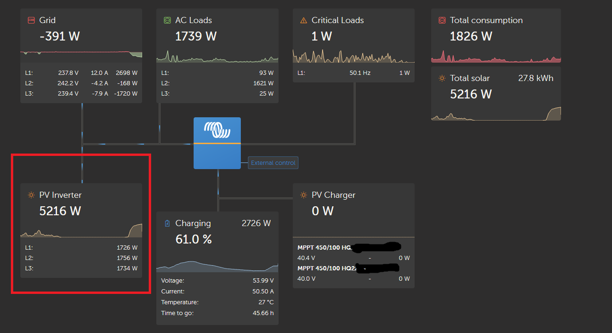
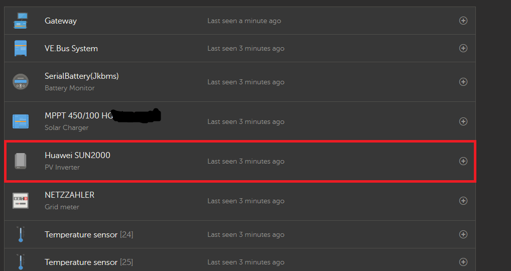

# dbus-huaweisun2000-pvinverter

D-Bus driver for Victron Cerbo GX / Venus OS for Huawei SUN 2000 inverters

## Purpose

This script is intended to help integrate a Huawei SUN 2000 inverter into the Venus OS and thus also into the VRM
portal.

I use a Cerbo GX, which I have integrated via Ethernet in the house network. I used the WiFi of the device to connect to
the internal WiFi of the Huawei Sun 2000. Note: No extra dongle is necessary! You can use the integrated Wifi,
which is actually intended for configuration with the Huawei app (Fusion App or Sun2000 App). The advantage is that no
additional hardware needs to be purchased and the inverter does not need to be connected to the Internet.

To further use the data, the mqtt broker from Venus OS can be used.

## Todo

- [ ] Display alarm values
- [ ] more values: temperature, efficiency
- [ ] clean code
- [ ] If possible, identify the meter model (DDSU666-H or DTSU666-H) and serial number
- [ ] Make register set configurable so that more SUN2000 models can be supported
- [ ] Add support for multiple inverters
- [ ] Venus OS gui-v2 support

## Installation / Update

1. When updating, read the CHANGELOG.md to see whether there are breaking changes that need your attention.

2. Download and run the installation / update script:

   ```bash
   wget -qO- https://raw.githubusercontent.com/kcbam/dbus-huaweisun2000-pvinverter/main/setup/install_or_update.sh | bash
   ```

   This will download the latest release and install it. If you want to install the development version, use:

   ```bash
   wget -qO- https://raw.githubusercontent.com/kcbam/dbus-huaweisun2000-pvinverter/main/setup/install_or_update.sh | bash -s dev
   ```

3. Edit the settings in the *V1* Remote Console under 'Settings -> PV inverters -> Huawei SUN2000'

   The driver will restart automatically, upon changes to the settings.

   If you can't change the settings via the GUI, you can override the settings via a config file by creating a file called `override_config.py`. Copy the `example_override_config.py` to `override_config.py` and adjust the values as needed. Note that this will override the settings in the GUI at any time and changing settings in the GUI will not have any effect.

## Power limit for ESS (experimental, off by default)

With "Allow ESS to limit the inverter" switched on, the driver publishes `/Ac/PowerLimit`,
so ESS can limit the inverter's feed-in the same way it does with a Fronius inverter.
Then set a feed-in limit in the ESS settings. Tested on SUN2000-30KTL-M3 and SUN2000-50KTL-M3.

You need this when the site may not feed all its PV into the grid: zero feed-in, or a
feed-in cap from the grid operator. ESS limits the inverter only while a feed-in limit is
set and the battery cannot take the surplus. Without a feed-in limit ESS never writes
`/Ac/PowerLimit` and the switch has no effect. Off-grid is not affected: there the Multi
limits the inverter by shifting the frequency, as before.

Without the V1 Remote Console, switch it on with
`dbus -y com.victronenergy.settings /Settings/HuaweiSUN2000/PowerLimitEnabled SetValue 1`
or `settings["power_limit_enabled"] = 1` in `override_config.py`.

The only register that limits these inverters exactly is 40125 (active power in percent of
the rated power), and the inverter stores it in flash. The driver therefore limits how often it
writes:

- The limit is rounded up to steps of 1 % of the rated power. Rounding down would leave
  the inverter below what ESS asks for; ESS then covers the load from the battery and
  never asks for more.
- Two writes are at least 15 s apart. ESS sends a new value every 5 s.
- A lower step is written as soon as that allows. A higher step is written only after
  ESS has allowed it for 30 s.
- While ESS keeps asking for more after a step up, the next one comes sooner: as soon as
  the inverter delivers the current step (it ramps up at a few hundred W/s) and ESS has
  asked for more for 15 s since. When a battery covers the gap, ESS asks for only a few
  hundred W more each time, so the steps then double (1, 2, 4 %, then 4 % each) and an
  11 kW load is followed in about 3 minutes instead of 12. The last one can overshoot by
  up to 4 %, taken back 15 s later. When ESS asks for several steps more, it gets the
  least it asked for within those 15 s.
- ESS has to ask for more than 100 W above the current step. At a steady state it sits
  a few W above, and the limit would otherwise swing between two steps.
- Going up stops after 120 writes within an hour. Going down always happens.
- While limited, the step is written again every 10 minutes. The inverter itself goes back
  to 100 % 15 minutes after the last write (register 42019), should the driver or the Cerbo
  stop. The driver lifts the limit itself when it is stopped or restarts for a changed
  setting, and after 60 s without a new value from ESS it goes back to full power (after
  the 30 s wait).

On start the driver sets register 42014 (remote power scheduling) to 1, which the inverter
needs to accept 40125, and 42019 to the fallback time. Both are written only if they differ.
A limit left from before a crash is kept until ESS asks for more, so the restart does not
let the inverter run at full power. `/Ac/PowerLimit` shows the limit in effect, not the
value ESS asked for.
Step size, wait time, fallback time and the hourly budget can be changed in
`override_config.py`, see `example_override_config.py`. Needs Venus OS with velib from
2023 or later.

This is not a fast control. If your installation needs zero feed-in within seconds, use
a solution with an energy meter at the inverter instead.

## Troubleshooting

In case you need an older version, you can install it (for example, replace the version in the end with the one you want):

   ```bash
   wget -qO- https://raw.githubusercontent.com/kcbam/dbus-huaweisun2000-pvinverter/main/setup/install_or_update.sh | bash -s v1.6.1
   ```

Check https://github.com/kcbam/dbus-huaweisun2000-pvinverter/tags for which versions exist.

An SDongle typically accepts only one Modbus TCP session at a time. Anything else
polling it, like Home Assistant, evcc or a second copy of this driver, will cause connection
errors on both sides. Rapid bursts of requests can also wedge the SDongle so that it accepts
connections but closes them without answering; in that case only restarting the inverter helped.


## Debugging

If things don't work: check Modbus TCP Connection to the inverter

   `python /data/dbus-huaweisun2000-pvinverter/connector_modbus.py`

You can check the status of the service with svstat:

`svstat /service/dbus-huaweisun2000-pvinverter`

It will show something like this:

`/service/dbus-huaweisun2000-pvinverter: up (pid 10078) 325 seconds`

If the number of seconds is always 0 or 1 or any other small number, it means that the service crashes and gets
restarted all the time.

When you think that the script crashes, stop the service and start it directly from the command line:

`python /data/dbus-huaweisun2000-pvinverter/dbus-huaweisun2000-pvinverter.py`

Also useful (note that you need to restart this often, as the "current" log file is rotated every few lines):

`tail -f /var/log/dbus-huaweisun2000/current | tai64nlocal`

### Stop the script

`svc -d /service/dbus-huaweisun2000-pvinverter`

### Start the script

`svc -u /service/dbus-huaweisun2000-pvinverter`

### Restart the script

If you want to restart the script, for example after changing it, just run the following command:

`sh /data/dbus-huaweisun2000-pvinverter/restart.sh`

## Uninstall the driver

Run

   ```bash
sh /data/dbus-huaweisun2000-pvinverter/uninstall.sh
rm -r /data/dbus-huaweisun2000-pvinverter/
   ```

## Examples





## Thank you

### Contributors

- DenkBrettl (current maintainer)
- ricpax (Energy meter code)
- okuegow (block reads, ESS power limiting)

### Used libraries

modified verion of <https://github.com/olivergregorius/sun2000_modbus>

### this project is inspired by

<https://github.com/RalfZim/venus.dbus-fronius-smartmeter>

<https://github.com/fabian-lauer/dbus-shelly-3em-smartmeter.git>

<https://github.com/victronenergy/velib_python.git>
